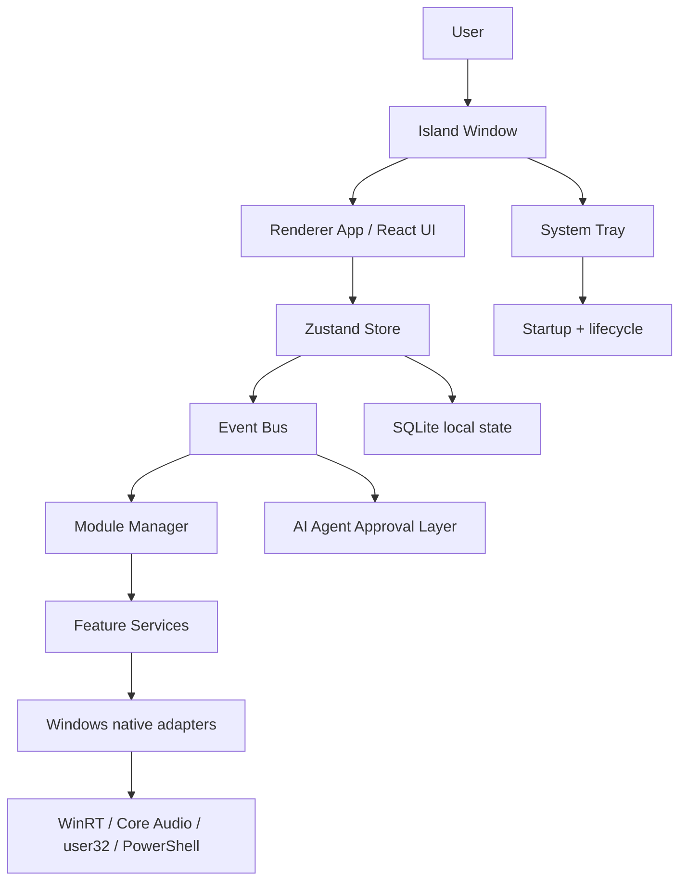

# NEXUS ISLAND ARCHITECTURE BLUEPRINT

## 1. Architecture goals

NEXUS should be a Windows-first floating assistant that is light on CPU, respects user privacy, and remains modular enough to support future feature services without building a giant monolith.

## 2. Proposed stack

Frontend:

- React 19
- TypeScript
- Vite
- Tailwind CSS
- shadcn/ui
- Motion
- Zustand
- Lucide React

Desktop:

- Electron
- Node.js
- TypeScript

Windows services:

- Win32 APIs and user32.dll where necessary
- PowerShell for scriptable system tasks
- WinRT media APIs and Core Audio
- SQLite for local state storage

## 3. Proposed folder structure

```text
NEXUS/
  app/
    main/
      index.ts
      app-lifecycle.ts
      single-instance.ts
      tray.ts
      updater.ts
      ipc.ts
    preload/
      index.ts
      bridge.ts
    windows/
      island-window.ts
      settings-window.ts
      overlay-window.ts
    services/
      media-service.ts
      battery-service.ts
      volume-service.ts
      bluetooth-service.ts
      wifi-service.ts
      clipboard-service.ts
      downloads-service.ts
      network-service.ts
      system-service.ts
      ai-agent-service.ts
      plugins-service.ts
    modules/
      activity-manager.ts
      module-registry.ts
      event-bus.ts
      state-store.ts
      priority-scheduler.ts
  renderer/
    src/
      app/
      components/
      modules/
      stores/
      hooks/
      styles/
  shared/
    contracts/
      ipc.ts
      events.ts
      activity.ts
      settings.ts
  data/
    sqlite/
    migrations/
    settings/
  scripts/
    windows/
    build/
```

## 4. System architecture diagram



## 5. Event-driven activity model

- Every feature emits typed events into a shared event bus.
- Activity manager handles priorities and state transitions.
- Modules can register and unregister dynamically.
- The controller decides compact vs expanded vs hidden UI state.

### Recommended event types

- activity:created
- activity:updated
- activity:completed
- activity:cancelled
- system:volumeChanged
- system:batteryChanged
- ai:sessionStarted
- ai:permissionRequested
- ui:island:expand
- ui:island:collapse

## 6. IPC contract

The IPC layer should be explicit and typed.

```ts
export type IPCRequest =
  | { type: 'system:stats'; payload?: {} }
  | { type: 'media:getState'; payload?: {} }
  | { type: 'agent:approve'; payload: { sessionId: string; decision: 'allow' | 'deny' } }
  | { type: 'ui:island:toggle'; payload?: { mode: 'compact' | 'expanded' } };

export type IPCResponse =
  | { ok: true; data: unknown }
  | { ok: false; error: string };
```

## 7. TypeScript interface examples

```ts
export interface ActivityItem {
  id: string;
  kind: 'ai' | 'media' | 'system' | 'timer' | 'custom';
  title: string;
  status: 'idle' | 'running' | 'waiting' | 'error' | 'done';
  priority: number;
  createdAt: number;
  expiresAt?: number;
  metadata?: Record<string, unknown>;
}

export interface WindowBounds {
  x: number;
  y: number;
  width: number;
  height: number;
}

export interface NativeFeatureService {
  start(): Promise<void>;
  stop(): Promise<void>;
  getState(): Promise<Record<string, unknown>>;
}
```

## 8. Module registration design

- Each feature module registers itself with a registry on startup.
- Registration includes lifecycle hooks and capability metadata.
- A global configuration file stores default priorities and enabled features.

Example:

```ts
registerModule({
  id: 'media',
  name: 'Media',
  enabled: true,
  priority: 40,
  service: mediaService,
  ui: {
    compactCard: 'MediaCard',
    expandedView: 'MediaPanel'
  }
});
```

## 9. Activity lifecycle

1. event arrives from a service or agent
2. controller normalizes it into an ActivityItem
3. priority scheduler decides placement and urgency
4. UI renders compact or expanded view
5. activity expires or resolves according to policy
6. completed activities are archived locally

## 10. State management strategy

- Zustand for UI-level state and interaction state
- SQLite for durable settings and historical events
- service-specific caches only where appropriate
- explicit hydration and restore on startup

## 11. Windows integration strategy

- Use official APIs, not undocumented internal access patterns
- Wrap each integration inside a robust service with fallback logic
- Keep APIs behind thin wrappers to maintain portability and testing

Examples:

- Media: Windows.Media.Control + WinRT
- Volume: Core Audio IAudioEndpointVolume
- Foreground window: user32.dll GetForegroundWindow
- Startup: app.setLoginItemSettings or registry-compatible startup tasks
- Notifications: Electron Notification or WinRT toast APIs

## 12. Error handling strategy

- Typed errors from services
- UI surfaces failure state without crashing the entire app
- Logs are local and privacy-safe
- Service-level retry and backoff logic for transient failures

## 13. Testing strategy

- unit tests for event bus and state transitions
- service tests against stubbed Windows APIs
- integration tests for IPC contracts
- E2E tests for island compact/expanded behavior
- smoke tests for startup, tray, and permission UX

## 14. Final recommendation

NEXUS should be built as a modular, event-driven desktop assistant with a lightweight island shell, explicit feature services, and a strong separation between the renderer, system services, and local data storage. The TwoCode code shows the product idea is strong; the implementation architecture should be cleaner and more durable.
