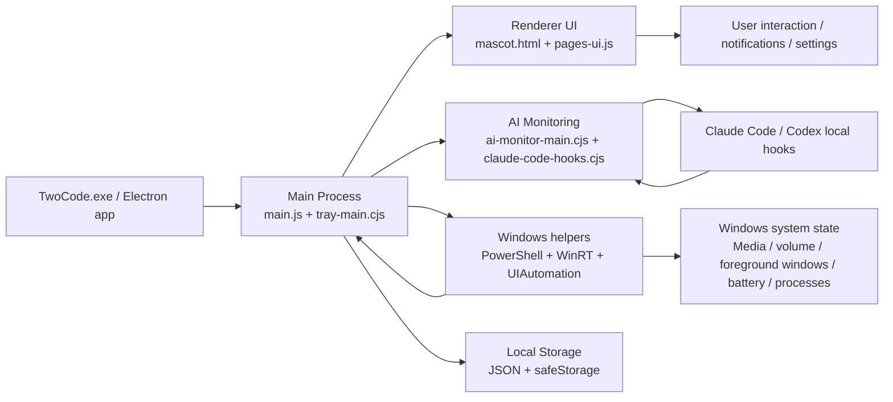

# TECHNICAL ARCHITECTURE

## 1. Architecture overview

The application is a classic Electron desktop app with a custom native-like shell and separate native helper scripts.

### Confirmed architecture components

1. Main process
   - resources/app/main.js
   - Electron app lifecycle, app startup, window management, module bootstrapping

2. Renderer UI
   - resources/app/mascot.html
   - JS files such as pages-ui.js, islands, settings-bridge-ui.js, focus-ui.js, extras-ui.js, ai-monitor-ui.js

3. Native Windows services
   - resources/app/windows-ai-access.ps1
   - resources/app/media-session.ps1
   - resources/app/volume-watch.ps1
   - resources/app/buddy-helper.ps1
   - resources/app/buddy-look.ps1

4. Background event flow
   - ai-monitor-main.cjs
   - claude-code-hooks.cjs
   - extras-main.cjs
   - system-main.cjs
   - settings-app-main.cjs

5. Local data storage
   - app.getPath('userData') JSON files
   - safeStorage used in project-mode-main.js

### Diagram

## 2. Programming language and framework evidence

### Confirmed

- JavaScript/CommonJS: package.json type commonjs
- HTML/CSS for interface shell
- PowerShell for Windows integration
- C# helper integration via windows-ai-access.cs and Win32/WinUI Automation APIs

### Inferred

- The app uses canvas and DOM rendering rather than React or other large UI frameworks.
- No React or Vite dependency is present in package.json.

### Unknown

- Whether there is a formal state management library beyond local JS modules is not evidenced in the bundle.

## 3. Data flow patterns

### Event flow model

- The island UI sends and receives messages through Electron IPC (`ipcMain.handle`, `ipcMain.on`).
- Local helper scripts continuously produce JSON activity streams, which are parsed and transformed into UI state.
- AI hook events are received on localhost and routed through app logic into UI status, notifications, and permissions.

### Persistence model

- JSON-based local preferences and runtime state in userData
- Some settings and AI work state can be stored in app-local files and are not obviously synced to a cloud service

## 4. Main process role

The main process does the following tasks:

- Starts the tray and app lifecycle
- Creates BrowserWindow for the island and related windows
- Registers global shortcuts
- Boots feature modules (AI monitoring, settings, focus, media, extras)
- Maintains user settings and local state
- Calls native PowerShell helpers to access OS state and UI automation

## 5. Renderer role

The renderer is mostly a custom DOM and canvas experience rather than a React app.

Evidence includes:

- mascot.html with a canvas and custom UI objects
- multiple JS files such as pages-ui.js, icons-ui.js, focus-ui.js, extras-ui.js, ai-monitor-ui.js
- global UI functions like `window.__twocodePrefs`, `window.__twocodeFocus`, and `window.__twocodeVolume`

## 6. Storage and security model

- Local JSON storage is the primary state model.
- Some encryption support is present through Electron `safeStorage` in project-mode-main.js.
- Important files are protected from obvious secret names (`credentials.json`, `.env`, `.pem`, keys, etc.) in project scanning.

## 7. Inter-process and native communication

- Electron IPC between main and renderer
- HTTP server on localhost for AI hooks
- PowerShell scripts reading system state and event streams
- Windows API calls via COM/WinRT/Automation and Process APIs

## 8. Architectural assessment

The architecture is service-like but not rigorously layered. It is a multi-module app that has grown via multiple feature files rather than a strict framework. This has advantages for speed and flexibility, but it also means:

- cross-module state is spread across app and local JSON
- feature lifecycle is not always centralized
- native integration is ad hoc and script-driven

For NEXUS, a cleaner event bus and service registry would be preferable.

## 9. Architectural opportunities

- Centralized event bus for all modules
- Stronger typed IPC contract
- Module manager for feature registration
- Smaller Windows helper layer with explicit permission boundaries
- Better state persistence and hydration
