# NEXUS ISLAND — Development Roadmap

**Status:** Active  
**Current Phase:** Phase 1 (Foundation & Modular Refactoring)  
**Target Platform:** Windows 11

---

## Roadmap Overview

```mermaid
flowchart LR
    P1[Phase 1: Foundation] --> P2[Phase 2: Island Engine]
    P2 --> P3[Phase 3: Windows System Engine]
    P3 --> P4[Phase 4: AI Engine]
    P4 --> P5[Phase 5: AI Cursor]
    P5 --> P6[Phase 6: Productivity & Companion]
    P6 --> P7[Phase 7: Customization]
    P7 --> P8[Phase 8: Database & Security]
    P8 --> P9[Phase 9: Testing & Optimization]
    P9 --> P10[Phase 10: Installer & Release]
```

---

## Phase Details & Deliverables

### Phase 1 — Foundation & Architecture Modularization 🔄 _(In Progress)_

- [x] Baseline Electron security configurations (`contextIsolation`, `sandbox`, `nodeIntegration`, `webSecurity`).
- [x] Elimination of legacy template code and obsolete `window.electron` references.
- [x] Initial typed bridge (`window.nexus.app.getInfo`, `window.nexus.island.setExpanded`).
- [x] Shared domain schemas via Zod (`app-info`, `island-state`).
- [x] Modularize `src/main` into structured subsystems (`windows/island-window.ts`, `ipc/app-handlers.ts`, `ipc/island-handlers.ts`, `ipc/register.ts`).
- [x] Display resilience baseline (`screen` event listeners, work-area bounds clamping).
- [x] Introduce Vitest test runner configuration (`vitest.config.ts`) and unit tests for shared validation schemas (`tests/unit/shared-schemas.test.ts`).
- [ ] **Next Milestone**: Renderer state management foundation (Zustand store for island expanded/widget states) & outside-click collapse (`blur`).

### Phase 2 — Island Engine Polish & Ergonomics

- [x] Compact pill (`220x64px`) and expanded card (`460x220px`) layouts.
- [x] Smooth CSS animations with `prefers-reduced-motion` compliance.
- [x] Display metric and resolution resilience (`screen.on('display-metrics-changed')`).
- [ ] Auto-collapse expanded island on desktop click-outside (`blur` / window deactivate).
- [ ] System tray icon for showing/hiding island and graceful exit.
- [ ] Smooth spring transitions / motion physics.

### Phase 3 — Windows System Integration Engine

- [ ] Windows Media Session API integration (Now Playing, track metadata, play/pause/prev/next).
- [ ] Windows Core Audio integration (master volume slider, mute toggle, default device info).
- [ ] System status monitoring (battery percent/charging state, CPU/RAM utilization metrics).
- [ ] Clipboard preview & quick actions.
- [ ] Windows notification integration.

### Phase 4 — AI Engine & Provider Architecture

- [ ] Pluggable AI Provider interface (`BaseAIProvider`).
- [ ] Local-first provider support (Ollama / Local HTTP endpoint).
- [ ] Cloud provider adapters (OpenAI-compatible, Anthropic, Google Gemini).
- [ ] Safe credential storage using Electron `safeStorage` (Windows DPAPI).
- [ ] Agent activity feeds, step-by-step task tracking, and approval request modals.

### Phase 5 — AI Cursor Engine

- [ ] Virtual cursor overlay window (smooth visual pointer showing planned AI actions).
- [ ] Task planner & step executor.
- [ ] Windows UI Automation & Win32 input injection (mouse click, drag, scroll, keyboard input).
- [ ] **Safety & Human Interrupt System**: Immediate physical input detection, key release, task freeze, and emergency stop shortcut (`Ctrl+Escape`).
- [ ] Security exclusions (password managers, UAC prompts, banking apps).
- [ ] Task-scoped screenshot captures with explicit user consent.

### Phase 6 — Productivity Tools & Original Companion

- [ ] Quick Notes widget with autosave.
- [ ] Focus / Pomodoro timer with island countdown pill.
- [ ] Quick Application Launcher shortcuts.
- [ ] Original NEXUS desktop companion character (interactive animations: Idle, Thinking, Working, Success, Alert).

### Phase 7 — Customization & Themes

- [ ] Windows 11 Fluent themes (Dark, Light, High Contrast, Mica/Acrylic accents).
- [ ] Island positioning options (Top Center, Custom coordinates, Display selector).
- [ ] Widget order & visibility toggles.
- [ ] Global hotkeys customization.

### Phase 8 — Database & Security Hardening

- [ ] Embedded SQLite database with migration framework.
- [ ] Encrypted table storage for user settings, notes, and activity audit trails.
- [ ] User SID isolation for Windows multi-user support.
- [ ] Sensitive-action confirmation guard (e.g. file deletion, external script execution).

### Phase 9 — Comprehensive Testing & Performance Tuning

- [ ] Unit test coverage for domain schemas, IPC handlers, and state management.
- [ ] Component testing with React Testing Library.
- [ ] Memory profiling and leak detection under 8 GB RAM constraints.
- [ ] CPU benchmark under idle and active animation states (< 1% target idle).

### Phase 10 — Production Installer & Release Packaging

- [ ] Assisted NSIS installer wizard (`oneClick: false`, customizable installation directory).
- [ ] Per-user and per-machine installation modes.
- [ ] Start Menu and Desktop shortcuts.
- [ ] Clean uninstaller with optional user data preservation prompt.
- [ ] Auto-updater integration with signed manifests.
